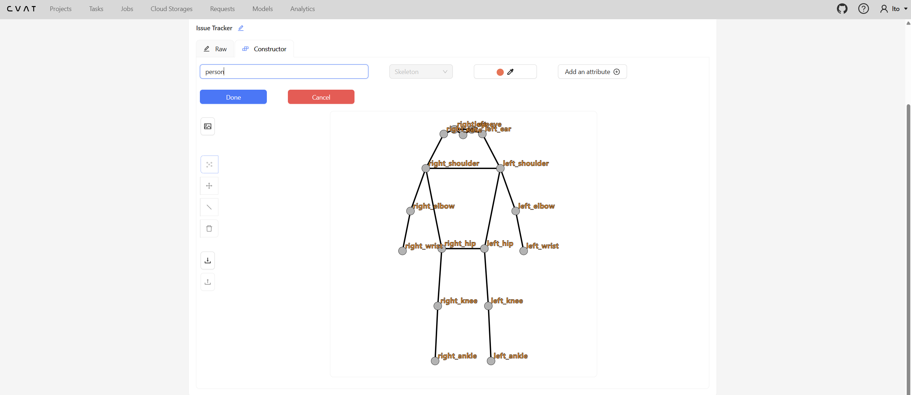
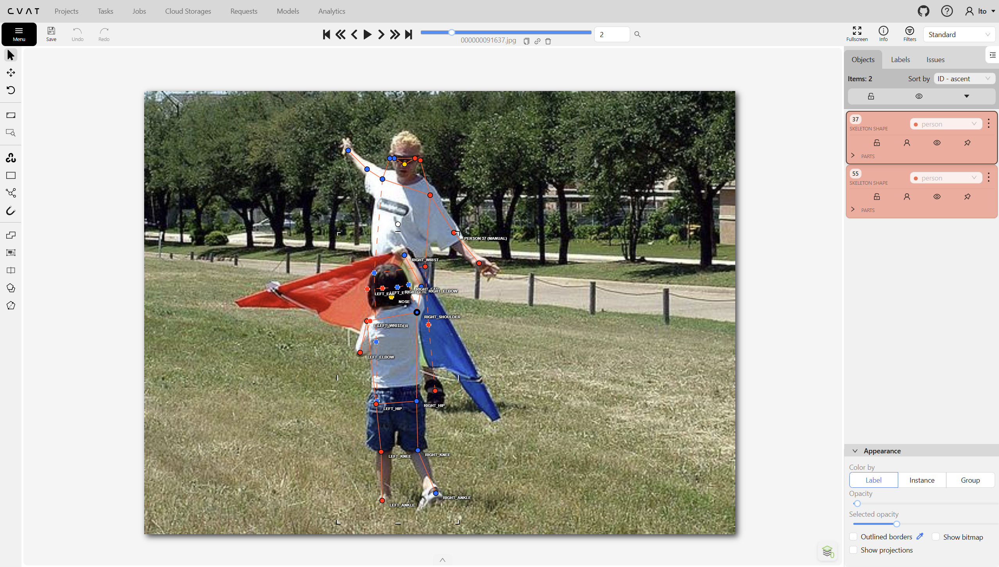
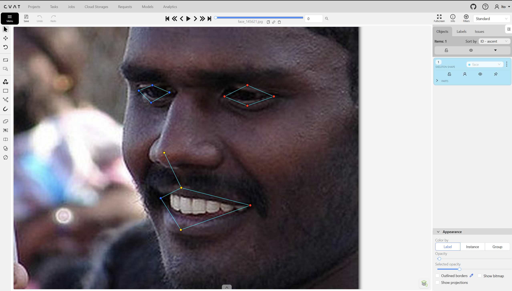
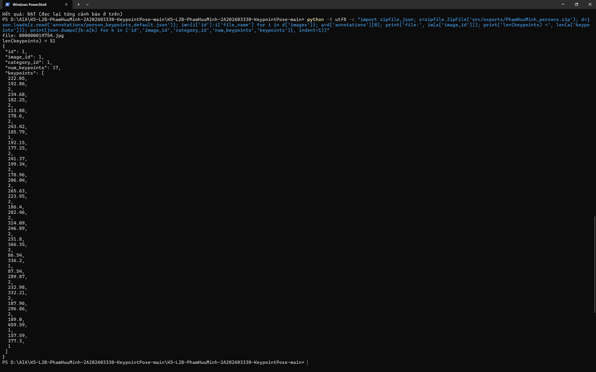

# Báo cáo cá nhân — PhamHuuMinh-2A202603330

Dữ liệu: 12 ảnh người COCO val2017 (Lin et al., 2014) và 8 ảnh chân dung cắt từ ảnh COCO, chỉ dùng trong lớp.

## 0. Thông tin học viên

- Họ tên: Pham Huu Minh
- MSSV: 2A202603330
- Link repository: https://github.com/lto7777777/K5-L2B-DAY4-PhamHuuMinh-2A202603330-KeypointPose
- Phiên bản CVAT (Help → About): 2.74.1
- Máy: hệ điều hành Windows 11 · RAM 32 GB · chạy CVAT chế độ đầy đủ
- Bộ ảnh (`src/exports/assignment.json` do `lab.py setup` tạo): có
- Giờ bắt đầu: 16:54 (12/11/2026, GMT+7)
- Giờ kết thúc: 18:25 (12/11/2026, GMT+7)

## 1. Kiểm tra label (CP0)

| Label | Kiểu | Số điểm | Tên điểm đúng bảng của lab? | Đúng thứ tự? | Số cạnh |
|---|---|---:|---|---|---:|
| `person` | Skeleton | 17 | Đúng | Đúng | 19 |
| `face` | Skeleton | 13 | Đúng | Đúng | 13 |

Tên và thứ tự điểm còn được xác nhận lại bằng `src/check_submission.py`: script đọc phần `categories` trong file xuất và báo 0 `[LỖI]`, nghĩa là không thiếu tên, không sai chính tả, không sai thứ tự, và tập cạnh khớp bảng của lab.

Mẫu `person` dựng theo người quay mặt về camera (các điểm `left_*` nằm bên phải khung mẫu)? Có

Cách đổi cờ `occluded` / `outside` cho **một điểm** trên phiên bản CVAT này (một câu):

Rê chuột vào đúng điểm cho tới khi điểm sáng lên rồi bấm `Q` để bật `occluded` hoặc `O` để bật `outside`, hoặc chuột phải vào điểm đó rồi chọn trong menu bốn nút; chỉ điểm đang rê chuột đổi cờ, các điểm còn lại của skeleton giữ nguyên.

## 2. Số lượng đã gán và thời gian (CP1, CP2)

| Nhóm ảnh | Số ảnh | Số skeleton đã gán | Số người dưới 60 px (không gán) | Số poster / gương / màn hình bỏ qua | Thời gian (phút) |
|---|---:|---:|---:|---:|---:|
| `easy` | 5 | 5 | 0 | 0 | 19,5 |
| `occluded` | 3 | 7 | 0 | 0 | 18,3 |
| `back` | 2 | 5 | 0 | 0 | 13,8 |
| `small` | 1 | 3 | 2 | 0 | 6,1 |
| `crowd` | 1 | 3 | 0 | 0 | 6,1 |
| `faces` | 8 | 8 | — | 0 | 14,9 |

Tổng: 23 skeleton `person` trên 12 ảnh và 8 skeleton `face` trên 8 ảnh. Hai người dưới 60 px đều nằm trong ảnh `000000100510.jpg` thuộc nhóm `small`; tôi đo chiều cao bằng một label rectangle phụ rồi không gán skeleton cho hai người đó.

- Số ảnh người đã xong ở mốc phút 105: 10 / 10
- Thời gian thực tế (phút): CP1 63,8 · CP2 14,9 · CP3 nằm trong hai con số trên, vì tôi tự review ngay trong hai job chứ không tách thành một lượt riêng
- Ảnh tốn thời gian nhất là ảnh nào, vì sao?

`000000123544.jpg` thuộc nhóm `back`, hết 9,2 phút. Ảnh có ba người, trong đó hai người quay lưng nên phải xác định hướng từng người trước khi đặt trái/phải, và một người có cổ chân trái nằm ngoài mép trái khung ảnh nên phải cân giữa `v = 1` và `v = 0`. Ảnh tốn thời gian thứ hai là `000000580257.jpg` với 8,5 phút.

Số liệu thời gian lấy từ log sự kiện của CVAT (bảng `cvat.events`), tính theo khoảng cách giữa các sự kiện liên tiếp trên cùng một frame và bỏ các khoảng nghỉ dài hơn 5 phút.

## 3. Bảng ca khó (CP1, CP2)

| Ảnh | Người / mặt | Điểm | Cờ đã chọn | Phân vân giữa | Lý do chọn |
|---|---|---|---:|---|---|
| `000000461389.jpg` | người #3 | `nose`, hai mắt, hai tai, hai vai, hai khuỷu, hai cổ tay (11 điểm) | `v = 0` | `v = 1` / `v = 0` | Cả phần thân trên nằm phía trên mép trên khung ảnh. Theo bảng cờ, điểm ngoài khung ảnh phải là `outside`, và không được kéo về mép |
| `000000461389.jpg` | người #2 | `nose`, hai mắt, hai tai (5 điểm) | `v = 0` | `v = 1` / `v = 0` | Đầu nằm phía trên mép trên khung ảnh, cùng lý do như trên |
| `000000123544.jpg` | người #2 | `left_ankle` | `v = 0` | `v = 1` / `v = 0` | Cổ chân nằm ngoài mép trái khung ảnh. Chọn `v = 0` thay vì kéo điểm về mép |
| `000000211458.jpg` | người #1 | `right_ankle` | `v = 0` | `v = 1` / `v = 0` | Cổ chân nằm dưới mép dưới khung ảnh |
| `face_301643.jpg` | mặt kính râm | 4 điểm mắt sau tròng kính | `v = 1` | `v = 1` / `v = 0` | Tròng kính tối nhưng vị trí mắt vẫn ước lượng chắc theo gọng kính, nên là `occluded` chứ không phải `outside` |
| `000000123544.jpg`, `000000480582.jpg` | người quay lưng và người nghiêng | mắt và tai phía xa camera | `v = 1` | `v = 1` / `v = 0` | Phần này bị chính đầu của người đó che. Vì vẫn thấy mắt và tai phía gần camera nên vị trí phía xa suy ra được chắc chắn, đúng với quy tắc tự che trong guideline |

## 4. Bảng tự review (CP3)

| Ảnh | Người / mặt | Điểm | Mã lỗi | Ghi chú | Đã sửa? |
|---|---|---|---|---|---|
| `000000461389.jpg` | người #3 | 11 điểm thân trên | `vis_flag` | Điểm mẫu CVAT tự đặt nằm trên mép trên khung ảnh nhưng vẫn để `v = 1`. Đã đổi sang `outside` | Có |
| `000000461389.jpg` | người #2 | 5 điểm vùng đầu | `vis_flag` | Cùng lỗi như trên, đã đổi sang `outside` | Có |
| `000000123544.jpg` | người #2 | `left_ankle` | `vis_flag` | Nằm ngoài mép trái khung ảnh nhưng vẫn để `v = 1`. Đã đổi sang `outside` | Có |
| `000000211458.jpg` | người #1 | `right_ankle` | `vis_flag` | Nằm dưới mép dưới khung ảnh nhưng vẫn để `v = 1`. Đã đổi sang `outside` | Có |
| `000000019754.jpg` | người #1 | cặp `wrist` | `ok` | Script cảnh báo cặp cổ tay nằm ngược phía so với các cặp khác. Đã kiểm lại bằng mắt: hai tay bắt chéo thật, không phải đổi trái/phải | — |
| `000000123544.jpg` | người #2 | cặp `hip`, `knee` | `ok` | Script cảnh báo. Đã kiểm lại: thân người xoay nên hông và gối nằm ngược phía so với vai, tên trái/phải vẫn đúng theo người | — |
| `000000332273.jpg` | người #2 | cặp `knee` | `ok` | Script cảnh báo. Đã kiểm lại, hai chân bắt chéo thật | — |
| `000000480582.jpg` | người #2 | cặp `knee`, `ankle` | `ok` | Script cảnh báo. Đã kiểm lại, hai chân bắt chéo thật | — |
| `000000580257.jpg` | người #2 | cặp `ankle` | `ok` | Script cảnh báo. Đã kiểm lại, hai chân bắt chéo thật | — |
| `face_301643.jpg` | mặt | 4 điểm mắt | `ok` | Kính râm tối, bốn điểm mắt để `occluded` đúng quy tắc | — |
| `face_145621.jpg` | mặt | — | `ok` | Mặt nghiêng, 13 điểm đặt đúng mép mí và khóe | — |
| `face_505385.jpg` | mặt | — | `ok` | Mặt nghiêng, không thấy lỗi | — |

Tổng hợp số lỗi theo mã:

| `lr_swap` | `vis_flag` | `position` | `missing` | `extra` | `ok` |
|---:|---:|---:|---:|---:|---:|
| 0 | 4 | 0 | 0 | 0 | 8 |

Điểm còn phân vân giữa `v = 1` và `v = 0` (ghi cả hai lựa chọn và lý do chọn):

Cả 18 điểm `v = 0` trong bài đều là điểm nằm ngoài khung ảnh, nên theo bảng cờ không còn gì phải phân vân. Nhóm thật sự phải cân nhắc là mắt và tai phía xa camera của người quay lưng hoặc người nghiêng. Tôi chọn `v = 1` chứ không phải `v = 0`, vì vẫn thấy mắt và tai phía gần camera nên vị trí phía xa suy ra được chắc chắn theo đối xứng. Nếu cả đầu bị che hẳn thì tôi sẽ chọn `v = 0`.

## 5. Kiểm file xuất và kết quả tự kiểm (CP4)

Tự kiểm tay trong file JSON:

| File | Người / mặt kiểm (ảnh, thứ tự) | Số phần tử `keypoints` | Điểm `outside` ra `v = 0`, `occluded` ra `v = 1`? | `num_keypoints` khớp? |
|---|---|---:|---|---|
| `PhamHuuMinh_persons.zip` | `000000019754.jpg` #1 | 51 | `occluded` ra `v = 1` đúng, 4 điểm. Người này không có điểm `outside` | Khớp: `num_keypoints` = 17, đếm được 17 điểm `v > 0` |
| `PhamHuuMinh_persons.zip` | `000000123544.jpg` #2 | 51 | Đúng cả hai: `left_ankle` `outside` ra `v = 0`; 4 điểm `occluded` ra `v = 1` | Khớp: `num_keypoints` = 16, đếm được 16 điểm `v > 0` |
| `PhamHuuMinh_faces.zip` | `face_301643.jpg`, mặt đeo kính râm | 39 | `occluded` ra `v = 1` đúng, 8 điểm sau tròng kính. Không có điểm `outside` | Khớp: `num_keypoints` = 13, đếm được 13 điểm `v > 0` |

Sau khi xuất, CVAT ghi `occluded` thành `v = 1` và `outside` thành `v = 0`. Tọa độ của điểm `outside` trong file là tọa độ cũ, không phải `0, 0`. Ví dụ `left_ankle` của `000000123544.jpg` #2 xuất ra `x = -4,36 · y = 259,45 · v = 0`. Chuẩn COCO ghi `0, 0`, còn CVAT 2.x giữ tọa độ cũ; điểm `v = 0` bị bỏ qua khi huấn luyện và khi chấm nên không ảnh hưởng kết quả.

Hai job đã chuyển sang completed trên CVAT? Có

Dán phần **TÓM TẮT** in ra từ `src/check_submission.py`:

```text
----- TÓM TẮT (dán vào báo cáo mục 5) -----
- File person: PhamHuuMinh_persons.zip
  Số ảnh: 12 · số skeleton `person`: 23 · mỗi annotation 51 số
  Skeleton theo ảnh: 000000019754=1, 000000057978=1, 000000091637=2, 000000100510=3, 000000123544=3, 000000177889=1, 000000211458=1, 000000332273=3, 000000455536=1, 000000461389=3, 000000480582=2, 000000580257=2
  Cờ v: v=2 299 (76%) · v=1 74 (19%) · v=0 18 (5%)
  num_keypoints trung bình: 16.2
- File face: PhamHuuMinh_faces.zip
  Số ảnh: 8 · số skeleton `face`: 8 · mỗi annotation 39 số
  Skeleton theo ảnh: face_145621=1, face_196742=1, face_301643=1, face_333134=1, face_3348=1, face_362568=1, face_380639=1, face_505385=1
  Cờ v: v=2 95 (91%) · v=1 9 (9%) · v=0 0 (0%)
  num_keypoints trung bình: 13.0
- Ghi chú: 18 điểm v = 0 vẫn mang tọa độ cũ (CVAT 2.x xuất như vậy; chuẩn COCO ghi 0, 0). Không phải lỗi: điểm v = 0 bị bỏ qua khi huấn luyện và khi chấm.
- Số [LỖI]: 0 · số [CẢNH BÁO]: 5
Kết quả: ĐẠT (đọc lại từng cảnh báo ở trên)
```

Các `[CẢNH BÁO]` còn giữ nguyên và lý do:

Cả 5 cảnh báo đều cùng một loại: script thấy một cặp điểm nằm ngược phía so với đa số các cặp còn lại của cùng một người, và cảnh báo rằng đó có thể là `lr_swap`, cũng có thể là tay chân bắt chéo thật. Tôi đã mở lại từng người trong CVAT và kiểm bằng mắt. Cả 5 trường hợp là tư thế bắt chéo hoặc thân người xoay, tên trái/phải vẫn đúng theo người trong ảnh, nên tôi giữ nguyên.

1. `000000019754.jpg` #1, cặp `wrist`: hai tay bắt chéo trước thân.
2. `000000123544.jpg` #2, cặp `hip` và `knee`: thân xoay nên phần dưới ngược phía so với vai.
3. `000000332273.jpg` #2, cặp `knee`: hai chân bắt chéo.
4. `000000480582.jpg` #2, cặp `knee` và `ankle`: hai chân bắt chéo.
5. `000000580257.jpg` #2, cặp `ankle`: hai chân bắt chéo.

## 6. Ảnh chụp màn hình

1. Label `person` trong label constructor (đủ 17 điểm có tên):

   

2. Một người quay lưng đã gán, cờ đã đặt:

   

3. Một khuôn mặt đã gán 13 điểm, phóng to vùng mắt:

   

4. Một đoạn JSON xuất của một người:

   

Nguồn ảnh: COCO val2017 / Wikimedia Commons.

## 7. Tự đánh giá

1. Lỗi bạn mắc nhiều nhất hôm nay, và cách bạn sẽ tránh ở dự án thật:

   Lỗi `vis_flag`, và chỉ một kiểu duy nhất. Khi tôi kéo khung bao lớn hơn phần người nhìn thấy được, CVAT tự đặt các điểm mẫu ra ngoài khung ảnh, và tôi để nguyên các điểm đó ở `occluded` thay vì `outside`. Tổng cộng 18 điểm trên 4 skeleton, nhiều nhất là một người trong `000000461389.jpg` với 11 điểm thân trên nằm phía trên mép trên khung ảnh. Nguyên nhân là tôi chỉ chỉnh những điểm nhìn thấy trên màn hình mà không kiểm các điểm bị đẩy ra ngoài vùng ảnh. Ở dự án thật tôi sẽ thu nhỏ khung nhìn sau mỗi người để thấy cả vùng xám quanh ảnh, xử lý hết các điểm nằm ngoài trước, rồi mới tinh chỉnh các điểm bên trong.

2. Một quy tắc bạn đề xuất thêm vào guideline (kèm ảnh ví dụ nếu có):

   Thêm một bước bắt buộc vào quy trình vẽ: ngay sau khi kéo khung bao, nếu khung vượt ra ngoài mép ảnh thì bật `outside` cho mọi điểm mẫu rơi ra ngoài khung ảnh, trước khi chỉnh các điểm bên trong. Guideline hiện đã nói rõ điểm ngoài ảnh phải là `outside` và không được kéo về mép, nhưng không nói nên làm việc đó lúc nào, nên rất dễ bỏ sót vì các điểm này nằm ngoài vùng nhìn mặc định. Guideline cũng nên nhắc thêm rằng CVAT không tự cắt điểm bị đẩy ra ngoài khung.

3. Nhãn của bạn đi vào model ở đâu? Chọn một lỗi bạn đã sửa và nói nó sẽ làm model học sai thế nào:

   Mỗi điểm `v > 0` trở thành một đỉnh heatmap mà model phải khớp, và cờ `v` quyết định trọng số trong loss: điểm `v = 0` có trọng số 0 nên model đoán gì ở đó cũng không bị phạt, còn `v = 1` và `v = 2` có trọng số 1 nên model học đúng theo vị trí tôi đặt. Lấy lỗi tôi đã sửa ở `000000461389.jpg` người #3: 11 điểm thân trên nằm phía trên mép trên khung ảnh mà vẫn để `v = 1`. Nếu giữ nguyên, model sẽ nhận 11 đỉnh heatmap nằm ngoài biên ảnh làm nhãn đúng cho vai, khuỷu và cổ tay, tức là bị ép học rằng các khớp đó nằm ở chỗ không hề có dữ liệu ảnh, và loss vẫn phạt khi model không đoán ra chúng. Sau khi đổi sang `v = 0`, 11 điểm đó có trọng số 0 và được bỏ qua cả khi huấn luyện lẫn khi tính OKS. Ngoài ra cờ sai còn phá bước lật ảnh khi tăng cường dữ liệu, vì lật ảnh đòi hỏi đổi tên từng cặp `left_*` và `right_*`.

## 8. Khó khăn và lỗi kỹ thuật

1. Đầu buổi CVAT không mở được ở `http://localhost:8080`. Nguyên nhân: sau khi Docker Desktop khởi động lại, hai container `traefik` và `cvat_vector` thoát với mã 127, vì Docker tự khởi động lại container trước khi WSL kịp tạo xong socket `docker.sock`. Sửa bằng `docker compose up -d` trong thư mục cài CVAT, không mất dữ liệu. Sau đó `python lab.py check` báo đủ 5 mục `[OK]`.

2. Chạy `python lab.py` trên Windows bị `UnicodeEncodeError` khi in tiếng Việt ra console. Sửa bằng cách thêm cờ `-X utf8`, tức là chạy `python -X utf8 lab.py ...` cho mọi lệnh của lab.

Cả hai lỗi đều xử lý xong trong buổi, không mất nhãn và không ảnh hưởng tới kết quả xuất file.

## Bonus (nếu làm)

Không làm bonus.

## 9. Tài liệu tham khảo và công cụ AI đã dùng

Tài liệu:

- `docs/GUIDELINE.md`, `docs/CVAT_CHEATSHEET.md`, `docs/COCO_KEYPOINTS.md`, `CHECKPOINTS.md` và `RUBRIC.md` của repo đề bài.
- Lin, T.-Y. và cộng sự (2014), *Microsoft COCO: Common Objects in Context* — nguồn ảnh và bộ 17 điểm.

Công cụ AI: Claude.
